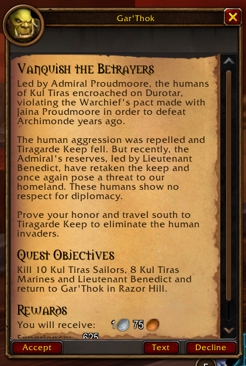
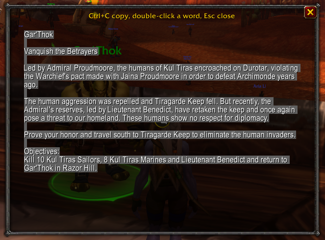
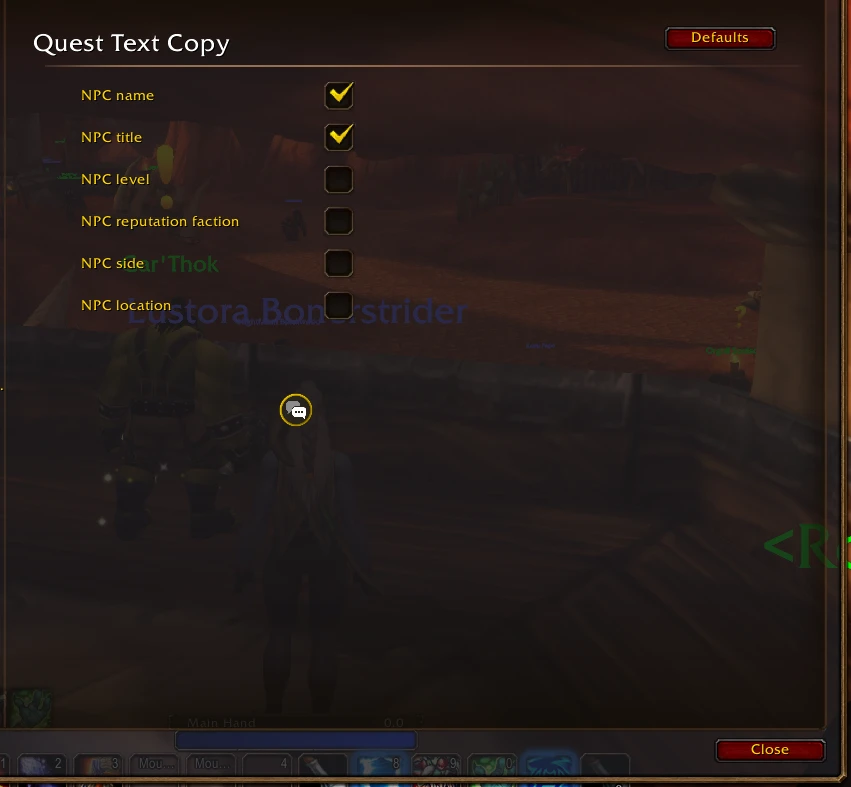

# Quest Text Copy

**Copy the text of quests, NPC dialogue, books and notes in one click.** Press the **Text** button in the window and a copy window opens with all the text already selected: press **Ctrl+C** and paste it anywhere outside the game (a translator, a document, a message to a friend).

WoW does not let addons write to the system clipboard, so the last step, Ctrl+C, is always yours.

*Русское описание ниже.*

## Features

- **Quest dialog with an NPC.** First who you are talking to, as on the nameplate: the NPC's name and its title below it, for example `Innkeeper Grosk` and `<Innkeeper>` (see Options). Then, when you take a quest: its title, description and objectives. When you turn it in: the progress text and the reward text. On an NPC's quest greeting: the greeting text plus the lists of current and available quests.
- **NPC conversations.** Who you are talking to (the same NPC lines), what they say, their current and available quests and the dialogue options.
- **Books, notes, letters, plaques** and other readable items and objects. The game shows one page at a time, so the addon remembers every page you flip through and copies them all with `Page 1:`, `Page 2:` headers. If there are pages you have not opened yet, the copy reminds you to flip through them.
- **Quest log.** Who gave the quest (the same NPC lines as in the dialog; remembered when you take a quest with the addon installed, so quests taken earlier have none), then the selected quest's title, description, objectives, progress (`[x]` done, `[ ]` not done) and its Quest ID. Works with the quest details on the world map (the **Text** button) and with the quest selected in your log (`/qcopy`).
- **Clean text.** Color codes, icons and textures are removed, and the formatting of books is turned into plain text.
- **Three ways to open it:**
  - the **Text** button inside the window: in the bottom row of the quest dialog and the NPC conversation, next to **Back** in the map's quest log, and a note icon next to the close button of a book or note;
  - the `/qcopy` or `/qc` command;
  - your own key: game key bindings, **AddOns** section, **Quest Text Copy**.
- **Any quest from your log by ID:** `/qcopy 12345` copies the quest with that ID, if it is in your log.
- **Options:** Esc > Options > AddOns > **Quest Text Copy**, or `/qcopy options`. Choose which NPC details go at the top of the text: name and title (on by default), level, reputation faction (Orgrimmar), side (Horde or Alliance) and location (the zone and subzone where you talked to the NPC or took the quest). They also apply to quest givers remembered earlier.
- **The copy window:**
  - All the text is selected when it opens. Ctrl+C copies it, the window closes and the chat says *Copied.*, so you can paste straight away.
  - Need only a part? Select it with the mouse or **double-click a word** (works with Cyrillic too, and `don't` stays one word). After a mouse click Ctrl+C keeps the window open, so you can copy the next piece. **Ctrl+A** selects everything again.
  - The text cannot be changed by accident: typing in the window brings the original text back.
  - Mouse wheel scrolls, drag the top strip to move the window, **Esc** or the close button closes it.
  - On a Mac use Cmd instead of Ctrl.
- The **Text** button always copies its own window. `/qcopy` and the key pick one when several are open: the quest dialog first, then the NPC conversation, then the book, then the quest log. If nothing suitable is open, the chat tells you what to open.
- English and Russian interface, following the game language.
- **Lightweight.** No Blizzard functions overridden; it saves only its options and who gave your quests.

## How to use

1. Open a quest, talk to an NPC, open a book or a note, or select a quest in your quest log.
2. Click **Text** in the window (or type `/qcopy`, or press your key).
3. A window opens with all the text selected. Press **Ctrl+C**.
4. Paste the text wherever you need it with **Ctrl+V**.

## Installation

Install it with the CurseForge app, or download the archive from [GitHub Releases](https://github.com/Ahri-ninetailed/QuestTextCopy/releases) and unpack the `QuestTextCopy` folder into `World of Warcraft\_forever_\Interface\AddOns`.

Game version: **WoW Forever**.

Source code and bug reports: [GitHub](https://github.com/Ahri-ninetailed/QuestTextCopy)

---

# Quest Text Copy (Русский)

**Копирование текста квестов, диалогов NPC, книг и записок в один клик.** Нажмите кнопку **Текст** в окне, и откроется окно копирования, в котором весь текст уже выделен: нажмите **Ctrl+C** и вставьте текст куда угодно вне игры (в переводчик, документ, сообщение другу).

WoW не разрешает аддонам записывать в буфер обмена, поэтому последний шаг, Ctrl+C, всегда за вами.

## Возможности

- **Квестовый диалог с NPC.** Сначала с кем вы говорите, как на табличке над NPC: имя и под ним звание, например `Innkeeper Grosk` и `<Innkeeper>` (см. настройки). Затем, когда берёте квест: название, описание и задачи. Когда сдаёте: текст о ходе выполнения и текст награды. В приветствии NPC: текст приветствия и списки текущих и доступных квестов.
- **Разговоры с NPC.** С кем вы говорите (те же строки NPC), его реплика, текущие и доступные квесты и варианты ответа.
- **Книги, записки, письма, таблички** и другие читаемые предметы и объекты. Игра показывает по одной странице, поэтому аддон запоминает каждую пролистанную страницу и копирует все сразу с заголовками `Страница 1:`, `Страница 2:`. Если какие-то страницы вы ещё не открывали, в копии будет напоминание их пролистать.
- **Журнал заданий.** Кто выдал квест (те же строки NPC, что и в диалоге; запоминаются, когда вы берёте квест с установленным аддоном, поэтому у квестов, взятых раньше, их нет), затем название выбранного квеста, описание, задачи, прогресс (`[x]` выполнено, `[ ]` не выполнено) и Quest ID. Работает с описанием квеста на карте мира (кнопка **Текст**) и с квестом, выбранным в журнале (`/qcopy`).
- **Чистый текст.** Цветовые коды, иконки и текстуры убираются, а оформление книг превращается в обычный текст.
- **Три способа открыть окно:**
  - кнопка **Текст** внутри окна: в нижнем ряду окна квеста и разговора с NPC, рядом с **Назад** в журнале заданий на карте, а у книги или записки — значок записки рядом с крестиком;
  - команда `/qcopy` или `/qc`;
  - своя клавиша: назначения клавиш в игре, раздел **Модификации** (AddOns), **Quest Text Copy**.
- **Любой квест из журнала по ID:** `/qcopy 12345` копирует квест с этим ID, если он есть в вашем журнале.
- **Настройки:** Esc > Настройки > Модификации > **Quest Text Copy** или `/qcopy options`. Выберите, что писать про NPC в начале текста: имя и звание (включены по умолчанию), уровень, фракцию репутации (Orgrimmar), сторону (Орда или Альянс) и место (зона и подзона, где вы говорили с NPC или взяли квест). Они действуют и на квестодателей, запомненных раньше.
- **Окно копирования:**
  - При открытии весь текст выделен. Ctrl+C копирует его, окно закрывается, а в чате появляется *Скопировано.*, так что можно сразу вставлять.
  - Нужна только часть? Выделите её мышью или **дважды щёлкните по слову** (работает и с кириллицей, а `don't` остаётся одним словом). После щелчка мышью Ctrl+C не закрывает окно, и можно скопировать следующий кусок. **Ctrl+A** снова выделяет всё.
  - Текст нельзя случайно испортить: если что-то набрать в окне, исходный текст вернётся.
  - Колесо мыши прокручивает, за верхнюю полосу окно можно перетащить, **Esc** или крестик закрывают его.
  - На Mac вместо Ctrl используется Cmd.
- Кнопка **Текст** всегда копирует своё окно. `/qcopy` и клавиша, если открыто несколько окон, выбирают сначала квестовый диалог, затем разговор с NPC, затем книгу, затем журнал заданий. Если ничего подходящего не открыто, чат подскажет, что открыть.
- Интерфейс на английском и русском, по языку игры.
- **Лёгкий.** Не переопределяет функции Blizzard; сохраняет только свои настройки и то, кто выдал ваши квесты.

## Как пользоваться

1. Откройте квест, заговорите с NPC, откройте книгу или записку или выберите квест в журнале заданий.
2. Нажмите **Текст** в окне (или введите `/qcopy`, или нажмите свою клавишу).
3. Откроется окно с выделенным текстом. Нажмите **Ctrl+C**.
4. Вставьте текст куда нужно через **Ctrl+V**.

## Установка

Через приложение CurseForge или скачайте архив из [GitHub Releases](https://github.com/Ahri-ninetailed/QuestTextCopy/releases) и распакуйте папку `QuestTextCopy` в `World of Warcraft\_forever_\Interface\AddOns`.

Версия игры: **WoW Forever**.

Исходный код и сообщения об ошибках: [GitHub](https://github.com/Ahri-ninetailed/QuestTextCopy)
